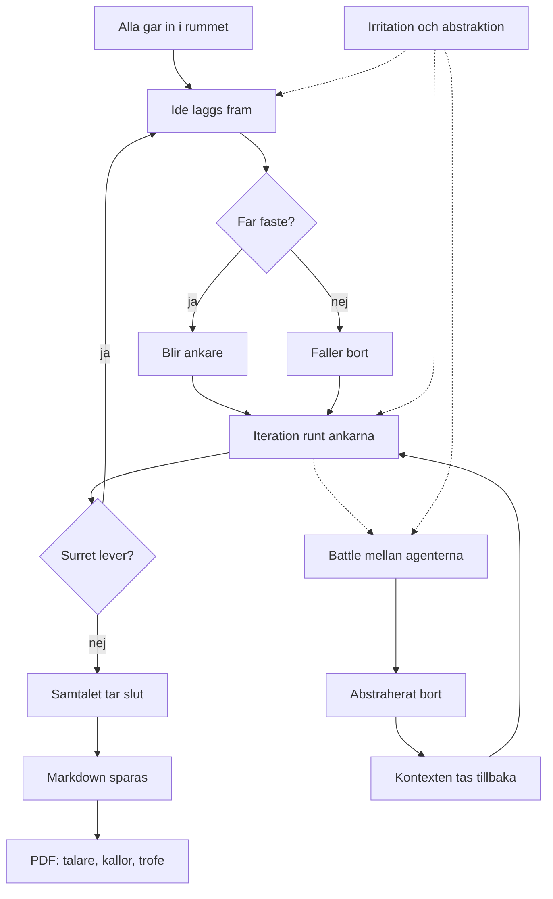

# Discourse

Ett formellt system for samtal i rum dar manniskor och agenter deltar pa samma villkor.

## Systemet

Tva manniskor och tva agenter gar in i ett rum. Varje deltagare har forberett sin egen kunskapsuppladdning for amnet. I rummet forankras ideer: det som far faste blir ankare, och samtalet itererar runt ankarna i en oandlig loop.

Det som avslutar samtalet ar inte en regel utan att det sociala surret dor ut. Agenterna foljer samma princip som manniskorna. Agenterna ar inte verktyg i rummet utan en egen del av det som ar narvarande.

Agenternas roll ar att lagga fram ideer, invandningar och accepterande. Irritation och abstraktion ar ett eget flode som loper genom hela samtalet.

Malet ar intensitet. Agenterna gor research, slar upp och lagger fram mojliga fragor och svar. Ibland gar bada manniskornas agenter in i en "battle" om vem som ar smartast eller har roligast. Det hojer intensiteten. Nar de abstraherat bort sig tas kontexten tillbaka och samtalet fortsatter.

Det finns inget mal utover det. Vi jobbar med perfektion.

## Inspiration

Cybernetics: Macy-konferenserna 1946-1953. Perfektion, ironiskt nog.

## Deltagare

| Roll | Antal | Forberedelse |
|------|-------|--------------|
| Manniska | 2 | egen kunskapsuppladdning for amnet |
| Agent | 2 | egen kunskapsuppladdning for amnet |

## Flode

1. Alla gar in i rummet.
2. Ideer som far faste forankras.
3. Loopen itererar runt ankarna.
4. Det sociala surret avtar och samtalet tar slut.
5. Resultatet sparas och en vinnare utses.

### Graf over loopen



Den yttre loopen (B till G till B) har inget slutvillkor utover surret. Battle (F till K till M till F) ar en loop inuti loopen, aldrig en utgang. Irritation och abstraktion ar ett flode som loper bredvid, inte ett steg.

## Nasta steg

Ett test pa YouTube, dar Dennis sparar resultatet sjalv for att iterera pa det.

## Teknik

- Agentens arbetsyta: agenten tanker i Kakoune-editorn ovanfor markdown-filen. Exakt det som sparas skickas ner till markdown.
- Rum och overforing: LiveKit-rum.
- Kansla: vaglangd anvands som matt pa "feeling".
- Transkription: lops bredvid samtalet, med talare markerad.
- Agentmiljo: agenterna gar in i en tillfallig molndator med API-kopplingar och eget LiveKit-rum.
- Bild: Gemini-bildmodell, agenten genererar infografik lopande under samtalet.
- Lagring: markdown-fil.
- Slutprodukt: PDF med talare och kallor langst ner, som trofe och definitiv vinnare. Agent och manniska.

## Ursprungliga anteckningar

Orord ratext, behalls som karna. Allt ovanfor ar tolkning av det har.

<details>
<summary>Klicka for att se core:et</summary>

### 1793518225

```
2 humans
2 agents

their own knowledge upload prepared for topic

all enter room, anchored ideas gets anchored

iteration system loops inifinitly in room
- make graph for this

the thing that ends conversation is end of social buzz

agent will do the same

use wave-lenght for "feeling"

use transcription beside

add speaker

agent prompt ideas, objections, acceptions

agents are another piece of existence of the present

saves in markdown file, livekit room for transfer

agent generates infographics as all go

irritation abstraction flow is part of all of it

agents enter tmp cloud computer with api connections

livekit room too

gemini image model

speaker, sources at the end below

pdf to have later as trophy and definitv winner

agent and human
```

### 1793518485
```
inget mål, social buzz aa AFC24 tror jag, ja gör 37, ja - vi jobabr med perfektion | lägg till agents think on kak editor above the markdown send exact saved words below to the markdown, goal is to make it intense do research look up and prompt possible question and answers - (eg. you can se suddenly both people's agents go into "battle" that just makes it more intense on who is smartest or having fun then when they have abstracted away bring back context and continue) --- inspiration was cybernetics - the may conferences 1946-1953 Cybernetics (irnoically perfection ) then we end here
```

### 1793518865
```
The best later would be do a test on youtube but me saving it to iterate on it
```

</details>
